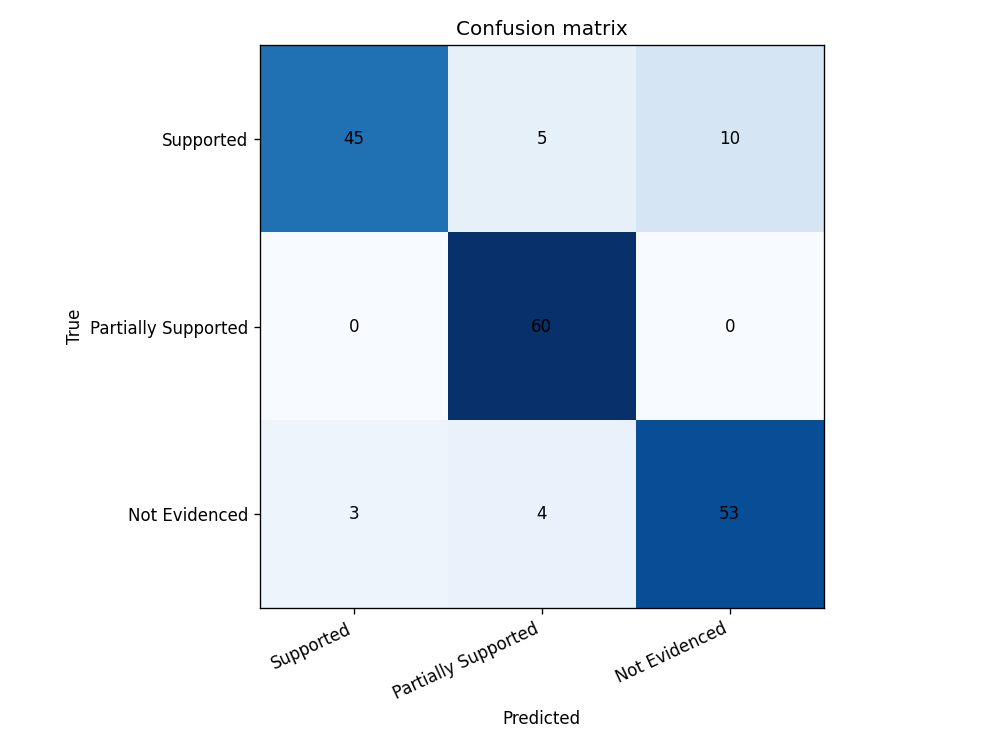

# Claim Evidence Support Classifier

A fine tuned text classifier that reads one job requirement (the claim) and one resume style snippet (the evidence) and decides how well the evidence backs the claim: **Supported**, **Partially Supported**, or **Not Evidenced**. It uses `microsoft/deberta-v3-base` as a sequence pair classifier with PEFT LoRA adapters, so only about 888K of 185M parameters train. On a held out test set of 180 rows it reaches **Macro F1 0.8751**, against 0.3167 for a frozen backbone baseline and 0.1667 for a majority class baseline.

The trained adapter (about 3.5 MB), the data, the full run metrics, and a local Gradio demo are all in this repo.

LinkedIn writeup: [Claim Evidence Support Classifier post](https://www.linkedin.com/feed/update/urn:li:share:7512537159145328640/)

## Example

```
Claim:    The candidate must have production experience with PostgreSQL.
Evidence: At Copper Street Bank, the backend engineer ran MySQL in production for 5 years and owned live incidents.
Label:    Not Evidenced
```

A keyword match or a similarity score would rate that pair as close: same role, same years, a related database. The model has to learn that MySQL does not prove PostgreSQL, that 2 years does not meet a 6 year requirement, and that a class project is weaker than production work.

## Results

Full run: 4 epochs on 840 training rows, best adapter picked by validation Macro F1 (0.8704). The test split was never used for model selection.

<table>
  <tr><th>Method</th><th>Macro F1</th><th>Supported F1</th><th>Partially Supported F1</th><th>Not Evidenced F1</th></tr>
  <tr><td>Majority class</td><td>0.1667</td><td>0.5000</td><td>0.0000</td><td>0.0000</td></tr>
  <tr><td>Frozen backbone, trained head only</td><td>0.3167</td><td>0.5050</td><td>0.0328</td><td>0.4124</td></tr>
  <tr><td><b>DeBERTa v3 Base + LoRA</b></td><td><b>0.8751</b></td><td><b>0.8333</b></td><td><b>0.9302</b></td><td><b>0.8618</b></td></tr>
</table>

Test accuracy is 0.8778. The model missed 22 of 180 test rows.



What the errors show:

* Partially Supported has perfect recall (60 of 60). The model reliably spots "right tool, fewer years" and "course instead of production".
* Supported is the hardest class (recall 0.75): 10 rows went to Not Evidenced and 5 to Partially Supported. Quoted misses include aliases such as Elastic Search for Elasticsearch and Dynamo for DynamoDB.
* A few near misses still leak through, for example Kubernetes evidence called Supported for a Docker claim.

The full breakdown with quoted mistakes is in [outputs/full/error_analysis.md](outputs/full/error_analysis.md). Raw numbers are in [outputs/full/metrics.json](outputs/full/metrics.json) and [outputs/full/report.txt](outputs/full/report.txt).

Recorded with torch 2.6.0+cu124, transformers 5.18.0, and peft 0.21.1 on an RTX 3080 Ti. A repeat GPU run can shift the score slightly because some CUDA kernels are not fully deterministic.

## Labels

**Supported.** The evidence clearly covers the claim. Paraphrase and common aliases count, so Postgres can support a PostgreSQL claim, and 7 years can support an "at least 5 years" claim.

**Partially Supported.** The evidence covers only part of the claim. The right tool with fewer years, one of two required skills, or course work where the claim asks for production experience.

**Not Evidenced.** The evidence does not support the claim. This includes hard negatives on a related tool (AWS versus GCP, Docker versus Kubernetes, PostgreSQL versus MySQL, React versus Angular), evidence that names the tool only to say it was not used, and unrelated work. Matching years on the wrong tool is still Not Evidenced.

Full definitions and examples: [docs/labels.md](docs/labels.md).

## How it works

* **Data.** `scripts/prepare_data.py` generates 1200 synthetic claim and evidence pairs with seed 42, balanced across the three labels and ten patterns (see [data/README.md](data/README.md)). It writes a stratified 70 / 15 / 15 split to `data/train.jsonl`, `data/val.jsonl`, and `data/test.jsonl`.
* **Model.** DeBERTa v3 Base with a 3 way classification head. Claim and evidence are tokenized as a pair, max length 256.
* **LoRA.** Rank 8, alpha 16, dropout 0.05 on the `query_proj` and `value_proj` attention projections. The backbone stays frozen. The pooler and classifier are fully trainable. 887,811 trainable parameters out of 185,312,262.
* **Training.** Learning rate 0.0002, batch size 8 with gradient accumulation 2 (effective 16), 4 epochs, fp16 mixed precision on CUDA. Validation Macro F1 after each epoch decides which adapter is kept.
* **Baselines.** A majority class predictor, and a frozen backbone run that trains only the pooler and classifier (592,899 parameters, 3 epochs, learning rate 0.001). Same test rows for all three methods.

This is standard LoRA, not QLoRA. Base weights load in float32 and are not quantized.

### Why a classifier and not retrieval

The evidence snippet is already chosen. The task is to judge it. Retrieval finds related text, but it does not decide between full support, partial support, and a near miss like AWS in the claim and GCP in the evidence. Fine tuning on labeled pairs learns that boundary directly.

## Quickstart

Python 3.10 or newer. Run everything from the repository root.

### 1. Create a virtual environment and install

macOS or Linux:

```bash
python -m venv .venv
source .venv/bin/activate
pip install -r requirements.txt
```

Windows PowerShell:

```powershell
python -m venv .venv
.\.venv\Scripts\Activate.ps1
pip install -r requirements.txt
```

For GPU training, install the PyTorch CUDA wheel that matches your driver from [pytorch.org](https://pytorch.org/get-started/locally/) first, then install the rest with `pip install -r requirements-no-torch.txt`. The first run downloads `microsoft/deberta-v3-base` from Hugging Face into `.cache/`.

### 2. Try the shipped adapter right away

The trained adapter is already in `adapters/lora`, so you can run inference or the demo without training.

```bash
python scripts/infer.py --adapter adapters/lora \
  --claim "The candidate must have production experience with PostgreSQL." \
  --evidence "At Copper Street Bank, the backend engineer ran MySQL in production for 5 years and owned live incidents."
```

It prints the predicted label and a probability for each class. On Windows PowerShell put the command on one line or replace each `\` with a backtick.

### 3. Run the Gradio demo

```bash
pip install gradio
python scripts/demo_ui.py
```

Open http://127.0.0.1:7860. The page has a claim box, an evidence box, class probabilities, and example buttons, including the PostgreSQL versus MySQL hard negative from the error analysis. Use `--port 7861` to change the port or `--adapter path/to/adapter` to load other weights.

### 4. Reproduce the full pipeline

```bash
python scripts/prepare_data.py --seed 42
python scripts/train_lora.py --config configs/train.yaml
python scripts/baseline.py --config configs/train.yaml
python scripts/evaluate.py --config configs/train.yaml
```

`prepare_data.py` rewrites the same rows for the same seed. `train_lora.py` writes the adapter to `adapters/lora`. `baseline.py` and `evaluate.py` write metrics, the confusion matrix, and the error analysis to `outputs/full`.

The full config targets a 12 GB NVIDIA GPU such as an RTX 3080 Ti, and a training run should finish within an hour there. If you run out of memory, set `batch_size: 4` and `grad_accum: 4` in `configs/train.yaml`. The effective batch stays 16.

### CPU smoke check

`configs/smoke.yaml` trains on 32 rows for 1 epoch on CPU to confirm the scripts run end to end. Its outputs are in `outputs/smoke`. Every method scores Macro F1 0.1667 there because an untrained head predicts one class. It is a wiring check, not a result.

```bash
python scripts/train_lora.py --config configs/smoke.yaml
python scripts/baseline.py --config configs/smoke.yaml
python scripts/evaluate.py --config configs/smoke.yaml
```

Note that the smoke run also writes to `adapters/lora` and will replace the shipped full run adapter. Check `adapters/lora/train_meta.json`: `run_name` should read `full`.

## Repository layout

```
adapters/lora/          trained LoRA adapter, label map, and train_meta.json (run_name: full)
configs/train.yaml      full GPU training config
configs/smoke.yaml      short CPU wiring check
data/                   train, val, and test jsonl files, stats.json, preview.txt
docs/labels.md          label definitions with examples
outputs/full/           full run metrics, report, confusion matrix, error analysis
outputs/smoke/          CPU smoke run outputs
scripts/prepare_data.py synthetic data generator and stratified split
scripts/train_lora.py   LoRA fine tuning with best validation checkpoint selection
scripts/baseline.py     majority class and frozen backbone baselines
scripts/evaluate.py     test metrics, confusion matrix, error analysis
scripts/infer.py        score one claim and evidence pair from the command line
scripts/demo_ui.py      local Gradio demo
src/cesc/               shared code: data loading, modeling, metrics, reports
requirements.txt        pinned dependencies
```

## Limits

* **Synthetic data.** All 1200 pairs come from a seeded generator with fixed sentence patterns and a small alias list. They are not real resumes or job posts. The test score shows that the training and evaluation setup works. It does not show how the model would do on real hiring text.
* **Rule based labels.** The generator assigns labels from the rules in `docs/labels.md`. There is no human rating pass and no agreement study. A hand written rule checker that knows the same tool pairs could also score well.
* **One pair at a time.** One claim against one snippet. No full resume parsing, no probability calibration, no threshold tuning.
* **Not a hiring tool.** This is a portfolio project that shows PEFT fine tuning and honest evaluation. It should not be used to screen real candidates.

## Related project

[CareerOS](https://github.com/7-ARK/careerOS) is a separate project of mine: a retrieval augmented job fit system that finds and grounds evidence across a resume and portfolio. This repo is independent of it. It covers a different skill, fine tuning a classifier with LoRA to judge a claim and evidence pair that is already given.

## Author

Ahmed Raza · [GitHub](https://github.com/7-ARK)
